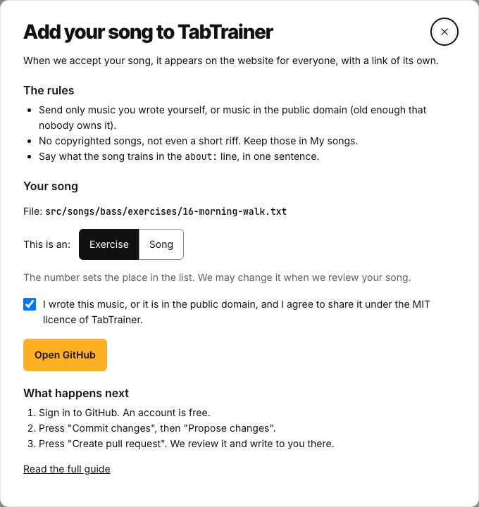

# Contributing to TabTrainer



Start here: [write a new song in TabTrainer](https://chemaclass.github.io/tabtrainer/?view=library&kind=mine&new=1).

TabTrainer is open source. Anyone can add an exercise or a public domain song to the site with a pull request on GitHub. Once we accept it, it shows up on the website for everyone, with a link of its own.

You can send a song from the app, which prepares the file on GitHub for you, or add the file by hand.

## Add a song from the app

You don't need to know Git. You need a free GitHub account.

1. Open your song in TabTrainer, or write a new one. Then open **File** in the editor and choose **Add to TabTrainer**. In My songs, you can also press **Add a song to TabTrainer** and pick the song.
2. The dialog shows the file name your song gets and a list of anything still missing. Close it, fix those lines in the editor, and open it again until the list is gone.
3. Choose **Exercise** or **Song**, and tick the box that says you wrote the music or that it is in the public domain.
4. Press **Open GitHub**. A new tab opens with your file named, in the right folder, and filled in. If your song is too long for the link, the app copies it for you: paste it into the empty box.
5. On GitHub, sign in, press **Commit changes**, then **Propose changes**, then **Create pull request**. We review it and reply there.

## Add a song by hand

1. Fork the repository and add your file where [Where the file goes](#where-the-file-goes) says, with the lines in [What the file needs](#what-the-file-needs).
2. Run `npm test` to check it. See [Checks](#checks).
3. Open a pull request with the file.

## What we accept

- Exercises and songs you wrote yourself.
- Songs in the public domain: old enough that nobody owns them, or traditional.
- One exception: a common practice pattern, such as a scale or a chromatic walk, taken from a teacher's free lesson. Credit the teacher in `artist:`, say so in `about:`, and link the lesson in `listen:`.

We don't accept copyrighted songs, not even a short riff. Keep those in My songs, in your own browser.

By sending a song, you share it under the [MIT licence](LICENSE) of TabTrainer.

## Where the file goes

`src/songs/<bass|guitar>/<exercises|songs>/NN-name.txt`

- `bass` or `guitar` is the instrument. The `instrument:` line decides it.
- `exercises` or `songs` is the list the song appears in.
- `NN` sets the place in the list, easiest first. The app picks the next free number. We may change it in review.
- `name` comes from the title and gives the song its link, such as `?song=bass/first-steps`. Two songs for the same instrument can't share a name.

## What the file needs

The header lines come first, in this order:

| Line | What it holds |
| --- | --- |
| `title:` | the song's name |
| `artist:` | `TabTrainer` for an exercise. For a song, `<Composer> (public domain)` or `Traditional (public domain)` |
| `about:` | one sentence saying what the song trains, written for the player |
| `level:` | `easy`, `medium` or `hard` |
| `listen:` | optional: a link to a recording of the original |
| `instrument:` | `bass4`, `bass5`, `bass6` or `guitar6` |
| `tempo:` | beats per minute |
| `key:` | such as `C`, `Ab` or `F#m` |
| `time:` | such as `4/4` |

When a song has several versions, such as an easy and a hard one, you can put a `level:` line under each `== Name` line too.

Each version needs at least 4 bars, and every bar must add up to its time signature. An exercise with a version named `Challenge` needs at least 16 bars in it.

Here is the start of `src/songs/bass/exercises/01-first-steps.txt`:

```text
title: First Steps: open strings and roots
artist: TabTrainer
about: Start here. Open strings and fretted roots in quarter, half and whole notes, so you learn where each note sits on the neck.
level: easy
instrument: bass4
tempo: 76
key: C
time: 4/4

# Notes are fret.string. String 4 is your low E and string 1 is the G string.
# ":q" sets quarter notes until the next duration change.
@Open strings
:q 0.4 0.4 0.4 0.4 | 0.3 0.3 0.3 0.3 |
0.2 0.2 0.2 0.2 | 0.1 0.1 0.1 0.1 |
@Root notes
"C" 3.3 3.3 3.3 3.3 | "F" 1.4 1.4 1.4 1.4 |
"G" 3.4 3.4 3.4 3.4 | "C" :h 3.3 :q 5.2 r |
```

The notes, durations and other symbols are in the [Song format](README.md#song-format) section of the README.

## Checks

`npm test` runs `tests/songs.test.ts` on every bundled file. It fails on any reading problem, a missing `about:` or `level:`, a version with fewer than 4 bars, or a song that doesn't read back the same. On each pull request, CI runs lint, the typecheck and the tests.

## After the merge

When CI passes on `main`, `deploy.yml` publishes it to the website. Your song appears in the list with its own page.

## Code changes

Pull requests with practice features are welcome too. [Development](README.md#development) in the README shows how to run the app. Before you send a pull request, run:

```bash
npm run check
```

It runs lint, the tests and the build, which typechecks, and stops at the first failure.
