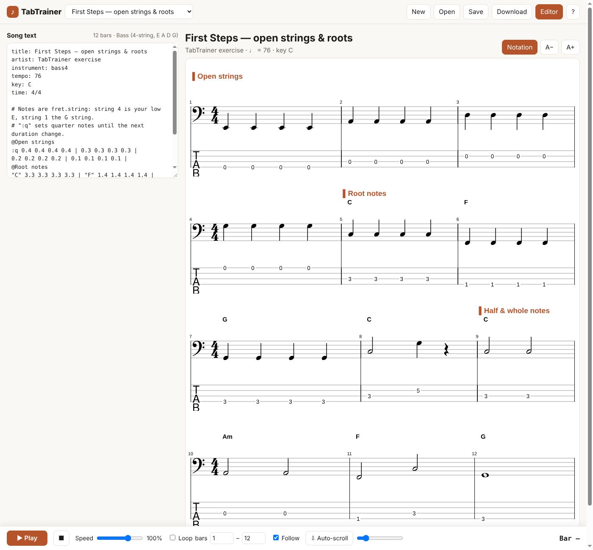

# TabTrainer

Learn electric bass and guitar songs from tab and notation. Slow a song down, loop the bars you miss, and follow each note as it plays.

TabTrainer is a free, open-source web app. You write or open a song as plain text, and it draws standard notation and tab together and plays them back.

**Try it:** https://chemaclass.github.io/tabtrainer/



## Features

- **Bass exercises and songs:** 10 exercises, from open strings to a Latin tumbao, and 6 public domain songs, from Ode to Joy to House of the Rising Sun. The song picker lists them in separate groups, easiest first, and each one says under its title what it trains.
- **Notation and tab** drawn one above the other and lined up note for note, with key signatures, ties, triplets and chords.
- **Playback** with a simple synth. Play, pause and resume, set the speed from 30 to 130%, and loop any range of bars.
- **Follow along:** each note turns red as it plays, and the page scrolls to keep the current line in view.
- **Auto-scroll** at a speed you choose. Press `S` to start or stop it, and `↑` or `↓` to change the speed.
- **Start anywhere:** double-click a note to play from there.
- **Editor with live preview:** each error or warning names the line it comes from.
- **Several versions of a song:** keep the plain bass line and a solo arrangement in one file, and switch between them with buttons under the title.
- **Instrument first:** pick bass or guitar, then a song for it. Bass has 4, 5 or 6 strings and guitar has 6. Both take a custom tuning, and ukulele song files open under guitar.
- **Songs stay on your device:** the app saves them in your browser. Download a song as a `.txt` file to move it to another device or share it. There is no account and no server.

## Song format

A song is plain text: a few header lines, then bars separated by `|`.

```text
title: My groove
about: Eighth notes on the root  # optional: what the song trains, shown under the title
instrument: bass4      # bass4, bass5, bass6, guitar6
tuning: D2 A2 D3 G3    # optional: any tuning, low to high
tempo: 90
key: C                 # C, Ab, F#m, ...
time: 4/4

@Verse
"C" :q 3.3 3.3 :8 5.2 5.2 :q 3.3 |
(3.3 5.2):h r:h |
[3/4] :8t 3.3 5.3 7.3 :q ~7.3 r |
```

| Syntax | Meaning |
| --- | --- |
| `3.4` | fret 3 on string 4 (string 1 is the highest) |
| `:q` | duration for the next notes: `w h q 8 16 32`. Add `.` for dotted and `t` for triplet |
| `3.4:8` | duration for one note |
| `(3.4 5.3)` | notes played together |
| `r` | rest |
| `~5.3` | tie: keep the note ringing without picking it again |
| `"Am7"` | chord name above the next note |
| `{let ring}` | text above the next note |
| `[3/4]` | time signature from this bar on |
| `@Chorus` | section name, on its own line |
| `== Bass line` | starts another version of the song, on its own line |
| `# ...` | comment |

### Several versions of one song

A song can hold more than one way of playing it, for example the plain bass line and a solo arrangement with melody and chords. Start each version with a `== Name` line. All versions share the header (title, instrument, key and tempo), and each version numbers its own bars from 1.

```text
title: My song
instrument: bass4
key: C

== Bass line
"C" :q 3.3 3.3 5.2 3.3 |

== Melody and chords
"C" :h (3.3 5.2) :q 5.1 7.1 |
```

## Development

```bash
npm install
npm run dev      # http://localhost:5173/tabtrainer/
npm test         # parser, timeline and demo song tests
npm run build    # production build in dist/
```

TabTrainer uses TypeScript, Vite and [VexFlow](https://www.vexflow.com/). The `.github/workflows/deploy.yml` workflow tests every push to `main` and deploys it to GitHub Pages.

```
src/
  core/     song model, text parser and serializer, timeline, instruments
  render/   notation and tab drawing (VexFlow)
  audio/    Web Audio player (scheduling, loop, speed)
  ui/       local song library and preferences
  songs/    demo songs: <instrument>/exercises/ and <instrument>/songs/ (original or public domain)
```

## Contributing

Pull requests for new exercises and practice features are welcome. Only send songs you wrote or that are in the public domain. This repository can't include transcriptions of copyrighted songs, but you can keep them in your own library.

## License

[MIT](LICENSE)
