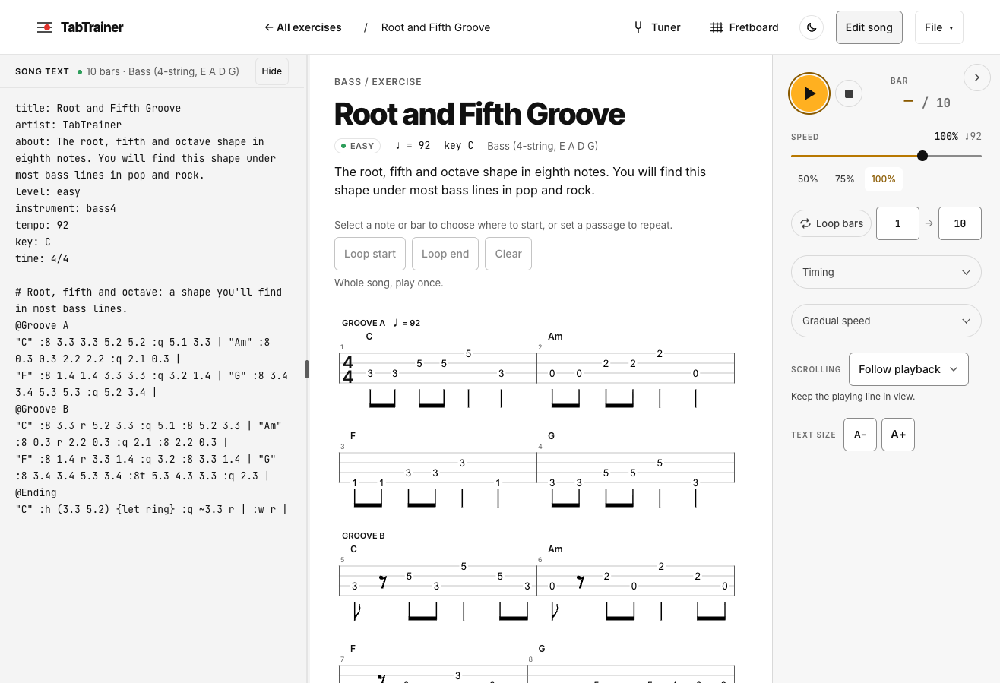

# TabTrainer

Practise electric bass and guitar from tab and notation. Slow a song down, loop the bars you miss, and follow each note as it plays.

TabTrainer is a free web app with no account and no server. Your songs stay in your browser.

**Try it:** https://chemaclass.github.io/tabtrainer/



## Features

- **Library:** exercises and songs for bass (4, 5 or 6 strings) and guitar. Search them, filter by level, and pick up where you left off.
- **Notation and tab** drawn together, note for note, with ties, triplets and chord names.
- **Playback:** set the speed from 30 to 130%, loop a range of bars, and raise the speed after a set number of loops. Add a metronome or a one-bar count-in.
- **Start anywhere:** select a note or bar, then press Play. `Space` pauses and resumes. Stop goes back to your selection.
- **Follow along:** the playing note turns red, and the page scrolls with it. Press `S` for continuous scrolling at your own speed.
- **Editor:** write songs in plain text and see the score update as you type. Errors name their line.
- **Jam:** improvise over a looping groove of drums, bass and keys in blues, rock, reggae or funk. Pick the key, tempo, chord progression and swing, and mute the part you play. Count in one bar before the loop starts, and share a link that opens the groove with your setup. Write your own grooves in the text format below, hear them as you type, and save them in your browser under Mine.
- **Fretboard:** see where the notes of any key and scale sit on your bass or guitar, as note names or degrees. Pick a mood, such as sad or dreamy, to get a scale and progressions that carry it.
- **Your files:** download a song or groove as `.txt` to share it or move it to another device, and open it again.

## Song format

A song is plain text: a few header lines, then bars separated by `|`.

```text
title: My groove
artist: Jane Doe, John Roe  # optional: who wrote it
about: Eighth notes on the root  # optional: what the song trains
listen: https://www.youtube.com/watch?v=...  # optional: the original
instrument: bass4      # bass4, bass5, bass6, guitar6
tuning: D2 A2 D3 G3    # optional: any tuning, low to high
tempo: 90
key: C                 # C, Ab, F#m, ...
time: 4/4

@Verse                 # section name
"C" :q 3.3 3.3 :8 5.2 5.2 :q 3.3 |
(3.3 5.2):h r:h |      # two notes together, then a rest
[3/4] :8t 3.3 5.3 7.3 :q ~7.3 r |
```

| Syntax | Meaning |
| --- | --- |
| `3.4` | fret 3 on string 4 (string 1 is the highest) |
| `:q` | length of the next notes: `w h q 8 16 32`, add `.` for dotted or `t` for triplet |
| `3.4:8` | length of one note |
| `(3.4 5.3)` | notes played together |
| `r` | rest |
| `~5.3` | tie: let the note ring without picking it again |
| `"Am7"` | chord name above the next note |
| `{let ring}` | text above the next note |
| `[3/4]` | time signature from this bar on |
| `@Chorus` | section name, on its own line |
| `== Bass line` | starts another version of the song, such as a solo arrangement |
| `# ...` | comment |

## Groove format

A groove is a backing loop to improvise over. Bundled grooves live in `src/grooves/`. The headers work like the song format; then each part gets one line of steps.

In Jam, My grooves has Edit text, New and Open file. The groove text opens above the chords. While every line reads cleanly, the loop plays what you type from the next bar; while a line has a problem, the list names its line and the last working version keeps playing. Save keeps the groove in this browser under Mine in the groove list. Download saves it as a `.txt` file, and Delete removes a saved groove after asking.

```text
title: My shuffle
genre: blues
about: A twelve bar shuffle to practise blues lines.
tempo: 80
key: A                 # the chords follow any key
time: 4/4
swing: 66              # 50 is straight, 66 is a triplet shuffle, up to 75
progression: I7 IV7 I7 I7 | IV7 IV7 I7 I7 | V7 IV7 I7 V7
voice: keys            # keys, organ or drive
kit: blues             # rock, blues, funk, reggae, jazz, metal or electronic
fill: on               # a tom fill at the end of the progression, off by default

hat:   xoXoxoXo        # one bar of 8 steps, repeated every bar
snare: ..X...X. | ..X..oX.
kick:  X...x... | X...x..o
keys:  ..X-..X-
bass:  1 - 3 - 5 - 6 - | b7 - 6 - 5 - >b1 -
```

| Syntax | Meaning |
| --- | --- |
| `genre:` | the style shown in the groove list, such as `blues`, `rock`, `reggae` or `funk` |
| `about:` | one line on what the groove practises, shown under the title |
| `swing:` | how late the off beat notes land: `50` is straight, `66` is a triplet, up to `75`. The Jam screen starts from this value, and its swing slider stops at the triplet |
| `progression:` | the chords the groove plays by default. The Jam screen can swap them for another progression |
| `voice:` | the sound of the keys part: `keys` (electric piano, the default), `organ`, or `drive`, a distorted voice for power chords |
| `kit:` | the drum sound and feel: `rock` (the default), `blues`, `funk`, `reggae`, `jazz`, `metal` or `electronic`. Each kit tunes the drums and how loosely they sit on the beat |
| `fill:` | `on` plays a tom fill over the last two beats of the progression, in place of the drum lines there. `off` is the default |
| `I7 iv bVII` | one chord per bar as a roman numeral: upper case is major, lower case is minor, `b` or `#` shifts it. Numerals count from the major scale of the key's root, so a minor key uses `i iv v bIII bVI bVII` |
| `7 maj7 m7 m7b5 dim sus4 5` | chord qualities after the numeral |
| `kick snare rim hat halfhat openhat pedalhat ride bell crash hightom midtom lowtom` | drum lines (`rim` is a cross stick, `pedalhat` the hi-hat closed by the foot, `bell` the bell of the ride): `X` accent, `x` hit, `o` soft hit, `.` silence. A closed or pedal hi-hat stops an open or half open one |
| `keys` | chord stabs: `X` accent, `x` stab, `-` hold the stab, `.` silence |
| `bass` | chord degrees separated by spaces: `1 2 3 5 6 b7 8`, `-` hold, `.` silence. `3` and `5` follow the chord, so `3` is the minor third of a minor chord and the root of a power chord. `b7` is the major seventh of a maj7 chord. Each bar moves by whole octaves to stay between E1 and G3, the range of a 4 string bass |
| `>5 >b1` | approach notes in the bass: `>` plays a degree of the next chord, in the octave nearest its root, so a walking line leads into the chord change. `>b1` is a half step below the next root, or a half step above when that falls below the bass range |
| `\|` | starts the next bar of a part; a part shorter than the progression repeats |
| `# ...` | comment, on its own line or after a space (`#IV` is a numeral) |

The steps in a bar set its grid. In 4/4 that is 8 for eighths, 12 for triplets or 16 for sixteenths. Swing moves the off beat eighths, or the off beat sixteenths when no part plays eighths. With another progression, each part repeats its bars over the new chords.

## Development

```bash
npm install
npm run dev        # http://localhost:5173/tabtrainer/
npm test
npm run lint
npm run typecheck
npm run build      # production build in dist/
```

The app uses TypeScript, Vite and [VexFlow](https://www.vexflow.com/). CI lints, typechecks and tests each push. When it passes on `main`, GitHub Pages publishes the site.

## Contributing

Pull requests with new exercises or practice features are welcome. Only send songs you wrote or that are in the public domain.

## License

[MIT](LICENSE)
