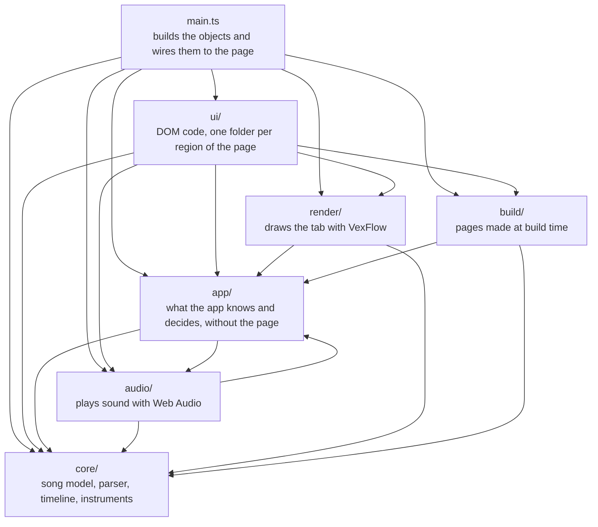

# How the code fits together

This page shows where new code goes in TabTrainer and how to test it. To run the app, see [Development](../README.md#development) in the README.

## The layers

The code under `src/` is split into layers. An arrow means "may import from".



- `src/core/` imports no other layer and never touches `document` or `window`.
- `src/app/` never touches `document` or `window`, and imports nothing from `ui`, `render` or `build`. It may use `localStorage`, so saved songs and preferences live here.
- `src/audio/`, `src/render/` and `src/build/` import nothing from `ui`.
- `src/ui/` holds the DOM code. `src/ui/dom.ts` has the shared element lookups, such as `byId`.
- `src/main.ts` holds no logic of its own, and nothing imports it.

`npm run lint` fails when code breaks one of these rules. The rules live in `eslint.config.js`.

The page itself is `index.html`: every button, panel and dialog starts there, and the code in `src/ui/` finds it by `id`. `src/styles.ts` imports the CSS in order.

## Where does it go?

| You want to add | Files to touch |
| --- | --- |
| A player control | The markup in `index.html`. The DOM code in a file under `src/ui/player/`, such as `src/ui/player/timingPanel.ts` for the metronome. What the sound does in `src/audio/player.ts`. One call in `src/main.ts` to build it. |
| A preference that survives a reload | A field in the `Preferences` interface and a check in `validators`, both in `src/app/storage.ts`. Read it with `pref('name', fallback)` and save it with `setPref('name', value)` from the code that owns the control. `src/ui/player/timingPanel.ts` does this for `metronome`. |
| A header line in the song format | The parser in `src/core/parser.ts` (the `HEADER` pattern and the line that reads it), the serializer in `src/core/serialize.ts`, and `HEADER_ORDER` in `src/core/songRules.ts` if bundled songs need it. Then document it in the [Song format](../README.md#song-format) section of the README and in the help dialog (`<dialog id="help">`) in `index.html`, with the same example. |
| A dialog | A `<dialog>` in `index.html`. The DOM code in the folder of the region that opens it, under `src/ui/`. `src/ui/shell/helpDialogs.ts` shows how the help dialogs open and close. One call in `src/main.ts` if it needs objects from elsewhere. |
| An instrument | An entry in `INSTRUMENTS` in `src/core/instruments.ts`. Then search for an existing id, such as `bass5`, to find the lists that name each instrument: the `instrument:` line in the README and the help dialog, the header table in [What the file needs](../CONTRIBUTING.md#what-the-file-needs), and the pickers. |

Any decision that does not need the page goes in `src/app/` or `src/core/`, so a test can check it. The file in `src/ui/` then only reads the page, calls that code, and shows the result.

## How to test it

- Code in `src/core/`, `src/app/`, `src/audio/` and `src/build/` gets a test in the matching folder under `tests/`, such as `tests/app/storage.test.ts` for `src/app/storage.ts`. The tests run in Node with Vitest, with no page.
- Code in `src/ui/` has no unit tests. Check it in the browser with `npm run dev`, on a wide screen and a phone-sized one, in light and dark. Sound starts only after a real click, not a scripted one.

Run one test file:

```bash
npm test -- tests/app/screenAwake.test.ts
```

Run the tests whose name matches some text:

```bash
npm test -- -t "counts a source once"
```

Before you send a pull request, run the checks in [Code changes](../CONTRIBUTING.md#code-changes).

## A worked example: keep the screen on

[Pull request #133](https://github.com/Chemaclass/tabtrainer/pull/133) keeps the phone screen on while a song plays, the Jam loop runs or the score scrolls on its own. The screen-on part touched these files.

1. `src/app/screenAwake.ts`: the decision. `ScreenAwake` remembers which sources are running (`'player'`, `'jam'`, `'scroll'`) and says whether the screen should stay on. It knows nothing about the browser.
2. `tests/app/screenAwake.test.ts`: tests for that decision, such as "stays awake while continuous scrolling runs after the player pauses".
3. `src/ui/player/wakeLock.ts`: the browser part. `screenWakeLock()` asks `navigator.wakeLock` to keep the screen on when `ScreenAwake` says so, lets go when it doesn't, and asks again when the tab comes back into view.
4. `src/ui/player/scrollControls.ts`: one new argument, so continuous scrolling can say when it starts and stops.
5. `src/main.ts`: the wiring. It builds the lock once and connects each source to it:

   ```ts
   const awake = screenWakeLock();
   player.on(state => awake.keep('player', state.playing));
   loop.on(state => awake.keep('jam', state.playing));
   ```

The rule lives in `src/app/` with a test, the browser call lives in `src/ui/`, and `src/main.ts` only connects them. Most features follow the same path.

## Colours, spacing and type

The design tokens live in `:root` in `src/style.css`, and `[data-theme="dark"]` sets the dark values of the colours. Use a token instead of a number in new CSS. When you touch an older rule, swap a literal for a token only when the values match exactly, so nothing on the page moves.

| Tokens | Values | Use them for |
| --- | --- | --- |
| `--space-1` to `--space-6` | 4, 8, 12, 16, 24, 32 px | `padding`, `margin` and `gap` |
| `--radius-s`, `--radius-m`, `--radius-pill` | 6, 12, 999 px | `border-radius`: buttons, cards, round pills |
| `--text-xs` to `--text-xl` | 12, 14, 16, 20, 28 px | `font-size`, or the size in a `font` shorthand |

The neutral colours carry the page: `--page` for the background, `--ink` for text, `--mut` and `--faint` for quieter text, `--rule` for lines, `--wash` and `--hover` for filled areas. The player bar at the bottom has its own set starting with `--deck`.

Three colours carry meaning. Use each one only for that meaning, so a player can read the page at a glance.

| Colour | Tokens | Means | Examples |
| --- | --- | --- | --- |
| Amber | `--led`, `--led-text`, `--track-fill`, `--cur` | Where you are and how far you got | The current line of the score, the filled part of a slider or progress bar, an exercise in progress, the target string in the tuner |
| Red | `--playing`, `--error`, `--problem-wash`, `--problem-text` | The note sounding now, or something to fix | The note that plays, a line the parser cannot read, a missing step in a song proposal |
| Green | `--ok`, `--ok-text` | Done or right | A finished exercise, a string in tune, a passed check |

Use the `-text` token for words and the plain one for fills and borders: the `-text` value is darker in light mode, so the words stay readable.
